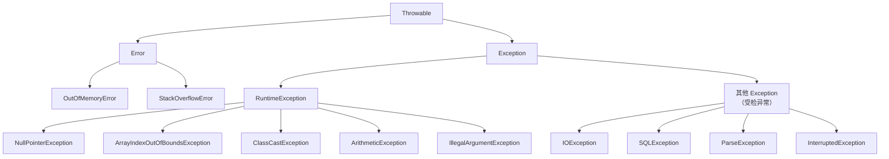

Java 的异常体系看似繁杂，但核心逻辑很清晰：所有问题都源于 `Throwable`，然后一分为二——`Error` 代表 JVM 层面的严重故障，程序通常无力回天；`Exception` 代表程序层面的问题，是开发者需要面对和处理的重点。在 `Exception` 之下，又根据编译器是否强制要求处理，分为**受检异常**与**非受检异常**。

### 🗺️ Throwable 体系总览



`Error` 与 `Exception` 的核心区别在于责任归属：`Error` 是运行环境（JVM、硬件）的问题，程序无法恢复；`Exception` 是程序逻辑或外部条件的问题，代码可以介入处理。

---

### 🔴 Error：JVM 的“绝症”

`Error` 表示 JVM 已处于无法继续正常执行的严重状态，**应用程序不应尝试捕获和处理 Error**。捕获它们往往无法解决根本问题，甚至可能掩盖真正的故障。

**常见类型与代码示例**

**`StackOverflowError`**：栈内存溢出，典型诱因是无终止条件的递归调用。
```java
public class StackOverflowDemo {
    static void recurse() {
        recurse(); // 无限递归，耗尽栈空间
    }
    public static void main(String[] args) {
        recurse(); // 抛出 java.lang.StackOverflowError
    }
}
```

**`OutOfMemoryError`**：内存耗尽，最常见的是堆空间不足（`Java heap space`），通常由无节制地创建对象导致。
```java
import java.util.ArrayList;
import java.util.List;

public class OomDemo {
    public static void main(String[] args) {
        List<byte[]> list = new ArrayList<>();
        while (true) {
            list.add(new byte[1024 * 1024]); // 持续分配 1MB，最终耗尽堆内存
        }
    }
}
```
面对 `Error`，正确的思路是排查代码（如消除无限递归、修复内存泄漏）或调整 JVM 参数（如 `-Xss`、`-Xmx`），而不是在 `catch` 块中“抢救”程序。

---

### 🟡 受检异常：编译器强制你面对的问题

受检异常继承自 `Exception`（但不包括 `RuntimeException`），编译器**强制要求**方法必须处理（`try-catch`）或声明抛出（`throws`），否则无法通过编译。它们通常对应**外部资源或环境**可能出现的问题，调用方有恢复的可能性。

**`IOException` 及其子类**：I/O 操作失败的统称，`FileNotFoundException` 是最常见的子类。

```java
import java.io.FileReader;
import java.io.IOException;

public void readFile(String path) throws IOException { // 声明抛出，由调用方处理
    FileReader reader = new FileReader(path); // 文件不存在时抛出 FileNotFoundException
    // ... 读取操作
}
```

**`SQLException`**：数据库访问错误，同样是受检异常，DAO 层方法通常需要声明 `throws SQLException` 或在方法内捕获处理。

**`InterruptedException`**：线程在 `sleep`、`wait` 等阻塞状态中被中断时抛出。处理时**必须恢复中断标志**，否则上层逻辑将无法感知中断请求。

```java
try {
    Thread.sleep(1000);
} catch (InterruptedException e) {
    Thread.currentThread().interrupt(); // 恢复中断状态，至关重要
    // 可根据情况决定是否继续向上抛出
}
```


---

### 🟢 非受检异常（RuntimeException）：代码逻辑的“信号灯”

非受检异常继承自 `RuntimeException`，编译器**不强制**处理。它们一旦发生，几乎总是指向**代码本身的逻辑缺陷或使用不当**。正确的做法是**通过前置检查来避免**，而不是大量使用 `catch` 来“兜底”。

| 异常 | 典型触发场景 | 代码示例 |
| :--- | :--- | :--- |
| **`NullPointerException`** | 对 `null` 引用调用方法或访问字段 | `String s = null; s.length();` |
| **`ArrayIndexOutOfBoundsException`** | 访问数组的索引超出了有效范围 | `int[] arr = new int[3]; arr[5] = 10;` |
| **`ClassCastException`** | 类型转换不兼容，且未通过 `instanceof` 检查 | `Object o = "text"; Integer i = (Integer) o;` |
| **`ArithmeticException`** | 整数除法中除数为零 | `int result = 10 / 0;` |
| **`IllegalArgumentException`** | 向方法传递了不合法或不恰当的参数 | `Thread.sleep(-1);` 会抛出此异常 |

以最常见的 `NullPointerException` 为例，Baeldung 的指南中给出了一个简洁的触发场景：
```java
String strObj = null;
strObj.equals("Hello World"); // ❌ 立即抛出 NullPointerException
```
对于这类异常，防御性编程（如 `if (strObj != null)` 或使用 `Objects.equals()`、`Optional`）比事后捕获更为有效。

---

### 🛠️ 异常处理的核心实践

除了认识异常类型，**如何编写处理代码**同样关键。

**优先使用 `try-with-resources` 管理资源**
对于 `InputStream`、`Reader`、`Connection` 等需要关闭的资源，`try-with-resources`（Java 7+）是标准做法。它会确保资源在代码块结束时自动关闭，**即使发生了异常**，并且能正确处理“关闭时也抛出异常”的抑制关系。

```java
// ✅ 推荐：自动关闭，代码简洁且安全
static String readFirstLine(String path) throws IOException {
    try (BufferedReader br = new BufferedReader(new FileReader(path))) {
        return br.readLine();
    }
}
```

作为对比，传统 `finally` 写法不仅冗长，在 `readLine()` 和 `close()` 同时抛出异常时，`close()` 的异常会**抑制**业务异常，导致排查困难。

**避免“吞掉”异常**
`catch (Exception e) {}` 或仅打印 `e.printStackTrace()` 而不做任何有效处理，会让问题在无声中扩散。至少应根据异常类型，记录日志、转换为更合适的异常向上抛出，或触发降级/重试逻辑。

**区分“可恢复”与“不可恢复”**
受检异常的设计初衷是提示调用方存在**可恢复的外部失败**（如网络超时、文件被占用），应积极处理；而非受检异常通常意味着**程序缺陷**，重点应放在修复缺陷本身，而非用 `catch` 掩盖它。

Java 的异常体系本质上是一套**沟通机制**：`Error` 告诉你环境已崩溃，`受检异常` 提醒你外部条件可能出问题，`非受检异常` 则指向你代码中的逻辑漏洞。理解每一种异常背后的“潜台词”，比记住它们的名字更有价值。
